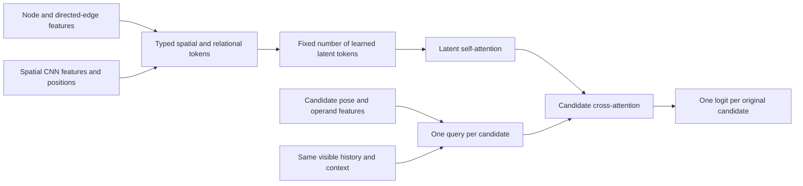

# Policy capacity and attention architecture review

## Status and recommendation

Review completed on 2026-09-10 against source `4607915` and the completed region
pilot. This is an experiment proposal, not an implemented architecture or a new
training run. The user requested careful consideration of larger models and a
substantially different architecture, including graph attention.

Keep the larger mean-message model as a capacity control. Add an edge-aware GATv2
actor as a focused aggregation experiment. For the substantially different
alternative, investigate a spatial/relational latent-attention actor whose output
queries describe individual candidate edits. The important hypothesis is whether
an action can retrieve the state information relevant to its particular move,
rather than whether an architecture has an attention label.

Do not remove spatial information or change candidate generation, region repair,
reward, history visibility or validation while testing these architectures.
The experiment belongs to iterative improvement of complete validated factories;
it preserves the constructive production lifecycle and exact-research separation
in `2026-09-02.00-constructive-layout-planner.md`.

## What the current implementation actually does

Sources: `tools/factory-edit-pilot/full_factory_input_contracts.py`,
`ppo_area_model.py`, `ppo_training_world.py`, `ppo_training_batch.py`, and
`crates/aic-pilot-native/src/full_factory/observation.rs`.

- A two-convolution CNN reads a 28-channel grid. Its kernel-based local receptive
  field is 5 by 5; GroupNorm statistics and later global pooling also introduce
  aggregate nonlocal dependence. The configurable `depth` does not deepen the CNN.
- The graph includes facilities, transport networks, individual transport cells,
  terminals, components, ports and external terminals. Typed directed edges carry
  ownership/connectivity, transport rate and direction information.
- Each graph layer transforms source features plus edge features, takes the mean
  incoming message, and updates the destination through a residual block. This is
  already an edge-aware GNN, not an architecture without graph reasoning.
- Network hub nodes connect many transport cells. Two graph layers are therefore
  not equivalent to two grid-cell steps; reach must be interpreted on this graph.
  Graph attention on unchanged edges does not itself increase that reach or add
  spatial proximity edges between unrelated commodities.
- The world summary averages all graph nodes and all raster positions. Transport
  cells consequently contribute many terms. Group-member embeddings are also
  averaged before scoring; local operand/member features remain separately useful.
- An MLP scores each candidate using action features, local samples, selected
  entity representations, group summary, global summary and a history GRU.
  There is no action-query-dependent retrieval over the other world nodes.
- The actor's `current-history-16` contract omits past outcome channels and the
  best-layout world. The critic sees current and best worlds. Adding outcomes or
  best-layout information would be a separate information-contract experiment.
- The normal batched learner manually executes encoder/scorer internals. Merely
  changing an actor's single-state `forward` would not change training correctly.

These are implementation observations. Mean pooling and limited propagation are
plausible bottlenecks, not demonstrated reasons for any particular bad decision.

## Measured scale and present learning evidence

Direct parameter enumeration of `ppo_area_model.models` gives:

| Graph depth / width | Actor | Critic | Total |
| --- | ---: | ---: | ---: |
| 2 / 32 | 50,977 | 32,961 | 83,938 |
| 2 / 64 | 175,681 | 106,881 | 282,562 |
| 4 / 32 | 57,377 | 39,361 | 96,738 |
| 4 / 64 | 200,769 | 131,969 | 332,738 |
| 2 / 128 | 646,273 | 377,601 | 1,023,874 |

Thus width 64 is a 3.37-fold total parameter increase; it is not a prediction of
a 3.37-fold runtime increase. Depth four at width 32 is only a 15.2% increase and
tests another mechanism. The region pilot still improves between batches 24 and
32, so it has not established an asymptotic capacity limit. Batch-32 critic
explained variance is 0.970 on the training targets, which is not held-out value
calibration or proof that the critic is sufficient. The final PPO update stops
after three epochs at sampled KL 0.0214 versus its configured 0.02 threshold.
Larger models must be checked for changed update behavior as well as final score.

Read-only measurements from all 992 accepted training states in region batch 32:

| Quantity per state | Minimum | Median | p95 | Maximum |
| --- | ---: | ---: | ---: | ---: |
| Graph nodes | 53 | 108 | 783 | 1,236 |
| Directed edges | 148 | 358 | 2,744 | 4,454 |
| Candidate actions | 38 | 205 | 2,732 | 4,373 |
| Grid cells | 84 | 209 | 2,993 | 8,134 |
| Nodes other than transport cells | 34 | 39 | 258 | 352 |
| Candidate member occurrences | 1 | 127 | 2,328 | 3,274 |

The largest observed node-square count is 1,527,696; the largest simultaneous
action-node product is 5,405,028. Four heads would produce about 82.5 MiB of FP32
action-node score entries for that state if materialized. This excludes gradients,
other activations and minibatching; fused attention may avoid materializing them
but still performs pairwise work. Dense attention is not proven infeasible, but
profiling only the median case would badly understate its cost. These are sample
measurements, not game limits, canvas limits or candidate caps.

Provenance: server runtime `/home/ashrimp/Srv/aic-ppo-region-20260910`, run
`artifacts/factory-edit-pilot/ppo-region-32-batch`, protocol SHA-256
`75f260f8991714d46cb1c303902e67b48919b79261f470516d762d90adc4c348`.
Read the training-32 record through its state manifest, use the hash-verifying
`ppo_area_update.load_experience`, and measure each saved `actor_observation`.
The p95 is sorted element `floor(0.95 * (n - 1))`. Parameter counts are reproduced
with `sum(p.numel() for p in model.parameters())` on each actor/critic pair.

## Candidate architectures

### Mean-message controls

Retain 2/32 as the measured reference, then compare 2/64 and 4/32. These answer
whether more channels or more graph propagation improve learning without a new
decision mechanism. Keep the CNN, candidate features, GRU, masking and reward
unchanged. Scaling both actor and critic is a combined capacity experiment;
do not interpret it as an actor-only result.

### Edge-aware GATv2 actor

Replace uniform incoming-message aggregation with query-dependent neighbor
attention. Retain directed topology and include the existing edge type, rate and
direction in attention scoring and message content. Keep the CNN, global readout,
member pooling and history mechanism initially unchanged. Use residual connections
and explicit handling of nodes with no incoming edges.

The original GAT has a restricted neighbor ranking that does not depend on the
query node; GATv2 removes this restriction. This makes GATv2 a better candidate
for testing state-dependent relevance. Our proposed edge-conditioned variant
still requires its own implementation and verification. Published results do not
establish suitability for this factory task. [Brody et al., ICLR 2022](https://arxiv.org/abs/2105.14491).

This is a focused architecture change. It cannot address every weak point: the
same topology still limits communication, and the final world/group averaging
remains. A negative result would not reject attention in general.

### Action-query latent-attention actor

This is the substantially different candidate. Replace the mean-message/global
summary decision path with a shared latent world representation and an output
query for every allowed or masked candidate in the unchanged full domain.

Use the existing raw information: node types and geometry, explicit directed
edges with their endpoint features, spatial channels and positions, member poses,
and the same visible history. Merely treating nodes as an unordered set and
discarding edge identity would lose the connectivity under investigation. Edge
tokens must retain both endpoints and direction; a two-stage relation encoder is
another possible implementation, to be fixed before the experiment. Preserve
local source/destination CNN samples alongside the latent readout so compressed
global context does not become the only geometric signal.

An initial engineering probe could use 32 latent tokens, width 64, four heads and
two latent blocks. With T input tokens, A candidates and L latents, attention
pair work is approximately O(TL + L squared + AL) per block arrangement, rather
than O(A times N) or O(A squared). Include node, edge and spatial tokens in T;
this is not a constant-cost architecture. Every candidate is still scored, with
query chunks if necessary; do not truncate the action domain to fit memory.

Perceiver IO supports inputs and output queries of different sizes through a
fixed latent representation. This motivates the proposed mechanism, not an
assertion that its published model will solve factory planning. [Jaegle et al.,
ICLR 2022](https://arxiv.org/abs/2107.14795).

The tradeoff is a new compression bottleneck and weaker built-in graph locality.
If query retrieval helps but edge structure is poorly retained, a hybrid with a
local GNN is a later ablation. GraphGPS separates local graph propagation from
global attention, providing a relevant design precedent; its linear-complexity
options should not be confused with ordinary dense attention. [Rampasek et al.,
NeurIPS 2022](https://arxiv.org/abs/2205.12454).

Attention-based learned routing also provides a precedent for querying encoded
state with a decision context. Its TSP/VRP setting and construction decoder differ
from transactional edits of routed factories, so its benchmark results do not
transfer directly. [Kool et al., ICLR 2019](https://arxiv.org/abs/1803.08475).

## Recommended bounded sequence

1. Run capacity controls first: fresh 2/64, followed by 4/32. Use the existing
   region 2/32 result as a reference only while its execution contract is unchanged.
2. Implement the GATv2 actor and latent-attention actor as explicit alternatives.
   Before training, enumerate actual parameters and profile median/p95/largest
   retained states, both CPU collection and CUDA learning. For architecture
   comparisons target the 2/64 actor's approximately 176,000-parameter budget,
   within 15% where practical; otherwise report the mismatch and add a matched
   mean-message control. Do not choose dimensions after looking at quality.
3. Compare these actors with the same 2/64 critic architecture and exactly the
   same initial critic weights as their mean-message control. Each critic then
   trains normally on its own run. Equal `manual_seed` calls alone do not ensure
   this: different actor constructors consume different amounts of RNG. Record
   explicit actor/critic initialization identities and separate streams or copy
   the declared reference critic initialization.
4. Each initial screen uses 32 fresh batches, the same 1,056 frozen starts, horizon
   32, route work 5,000, eight workers, CUDA FP32 and unchanged PPO hyperparameters.
   Evaluate at 0/8/16/24/32. Compare final scores and each architecture's change
   from its own untrained policy; different architectures cannot share all initial
   actor weights. Do not reuse an old policy's trajectories as if they were fresh
   on-policy PPO experience for a different model.
5. Treat the reused 32 evaluation factories as an architecture-selection set.
   Replicate promising candidates and their control with additional initialization
   seeds and then evaluate on untouched factories before making generalization
   claims. Longer training tests sample efficiency versus asymptotic performance;
   losing at 32 batches does not establish a model's eventual limit.

Preserve the seed-to-factory mapping explicitly when adding learner seeds: the
current harness derives generation seeds from learner seeds, and the retained
manifest covers seed 17. Additional replications need an explicit shared-input
mapping or freshly frozen matched datasets, not a silent missing-seed fallback.

Primary outcome remains paired best-area reduction. Also report per-product and
facility-count results, single/group/distant pose improvements, direct and future
action credit, and quality per episode/learner second. Future credit and attention
weights are descriptive signals, not causal explanations. Native legality rates
must be interpreted among the actions each policy actually selected.

## Implementation contract for a later slice

Input: the same versioned native observation DTO, immutable full candidate order,
allowed mask and visible history. Output: one finite logit per candidate and one
state value from the declared critic. The native executor remains the sole edit
implementation; the model does not generate unchecked geometry or routes.

Add an explicit versioned model specification and include architecture, depth,
width, heads, latent count, parameter counts, initialization identities and source
hashes in protocol/checkpoint metadata. Different experiment families are
intentional alternatives, not compatibility adapters. Archived runtimes remain
immutable. Do not load incompatible checkpoints through partial/non-strict loads.

The single-state collector and batched learner must execute the same mathematical
architecture. Prefer a shared prepared-forward implementation over duplicating
attention logic. Preserve independent graph boundaries, padding/masking semantics,
history visibility, world aliasing and all candidates in chunked execution.
Sparse segment softmax and any attention kernel must satisfy the existing FP32
determinism/continuation checks; do not quietly disable them for a faster kernel.

Required readiness evidence: finite logits/values and gradients, full masked
probability normalization, collector/batch agreement, isolation when a state is
batched with unrelated worlds, permutation consistency after reference remapping,
chunk-size agreement, and exact checkpoint/optimizer/RNG continuation on the
pinned backend. Exercise zero-edge nodes, empty history, large action sets and
current/best aliasing. Failed readiness returns structured architecture/kernel/
shape/resource diagnostics and does not start the comparison run.

Track actual input sizes, peak host/GPU memory, preparation time, inference time,
PPO update time, KL stops and entropy. Reaching the chosen training duration is
normal termination; genuine resource or numerical errors remain failures. Do not
alter the executor, reward, game data or action vocabulary to rescue a model.
